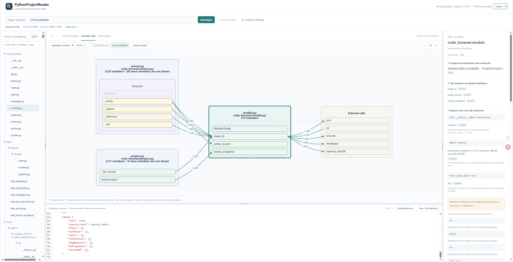

# PythonProjectReader

[简体中文](./README.md) | **English**

A standalone local tool for reading Python projects. It combines file relationships, function calls, internal logic, existing project documentation, and read-only source code to help you understand the implementation.

Core analysis and viewing work entirely offline, without an LLM, account, or paid API. The tool does not run the project being analyzed.

## Screenshot



Explore file navigation, function calls organized by file and class, documentation for the current definition, and read-only source code in connected views.

## Features

- View module descriptions, file comments, functions, classes, global variables, and objects.
- Explore incoming and outgoing file references and follow calls across files.
- Read call graphs organized into files, classes, and function rows, showing specific calls within and across files.
- Inspect function signatures, parameters, defaults, type annotations, return expressions, and call arguments.
- Locate local variable bindings and navigate to class and method definitions where they can be determined.
- Expand conditions, loops, exception handling, and other internal logic, and locate the calls within them.
- Navigate between relationship graphs, details, and read-only source code, with search, zoom, folding, and back/forward history.
- Drag the boundaries between navigation, the central reading area, and details, or between the central graph and source code, to adjust the space for each area.
- Dismiss message bars to reclaim reading space while keeping analysis status and diagnostics available.
- Use Chinese or English, with Chinese as the default. Switching languages preserves the reading context and does not translate or rewrite project source code or comments.
- Start and stop the tool with Windows or Linux scripts. It prefers port 8778 and automatically selects an available port when that port is occupied.

## Requirements

- Python 3.13.
- Node.js 22: needed only to install frontend dependencies, build the web assets for the first time, or update them.
- A modern browser.
- PowerShell 5.1 or later on Windows; the system `sh` on Linux.

Installing dependencies for the first time requires downloading open-source packages. Once dependencies are installed and the web assets are built, everyday analysis and viewing can run offline.

## Installation

After downloading or cloning the repository, prepare the environment from the project root.

### Windows

The `python` command below must point to Python 3.13. If you have multiple Python versions installed, use the appropriate 3.13 interpreter to create the virtual environment.

```powershell
python --version
python -m venv .venv
.\.venv\Scripts\python.exe -m pip install -r requirements.txt
cd web
npm.cmd ci
npm.cmd run build
cd ..
```

### Linux

```bash
python3.13 -m venv .venv
./.venv/bin/python -m pip install -r requirements.txt
cd web
npm ci
npm run build
cd ..
```

Web assets are built into `code_browser/static/`. This directory is not committed to the repository, so build the assets before starting the tool for the first time. Everyday operation does not require Node.js or a web development server.

## Starting and Stopping

### Windows

Start:

```powershell
powershell -NoProfile -ExecutionPolicy Bypass -File .\scripts\start.ps1
```

Stop from another terminal:

```powershell
powershell -NoProfile -ExecutionPolicy Bypass -File .\scripts\stop.ps1
```

Optionally prefill the target project directory or prevent the browser from opening automatically:

```powershell
powershell -NoProfile -ExecutionPolicy Bypass -File .\scripts\start.ps1 -Project "C:\path\to\python-project" -NoBrowser
```

### Linux

Start:

```bash
sh scripts/start.sh
```

Stop from another terminal:

```bash
sh scripts/stop.sh
```

Optional arguments:

```bash
sh scripts/start.sh --project "/path/to/python-project" --no-browser
```

The startup scripts prefer port 8778. If it is occupied, the operating system assigns an available port. Once the service is ready, the terminal displays its actual address, such as [http://127.0.0.1:8778/](http://127.0.0.1:8778/). The startup terminal continues to show service output. If a healthy instance is already running in the same workspace, starting again displays and reuses that instance's address.

The stop scripts locate the service using the instance record for the current workspace; you do not need to know its port. Stopping ends the tool's current analysis without modifying target project files. Service records and caches are stored in `work/runtime/`.

The scripts locate the project directory relative to their own location. You can also run them from another working directory using the full script path. Create a separate platform-specific `.venv` on Windows and Linux; do not share the virtual environment directory between them.

### Using the Python Entry Point Directly

You can also use the virtual environment's interpreter from the project root without activating the environment first.

Windows:

```powershell
.\.venv\Scripts\python.exe -m code_browser
.\.venv\Scripts\python.exe -m code_browser --project "C:\path\to\python-project" --no-browser
.\.venv\Scripts\python.exe -m code_browser --stop
```

Linux:

```bash
./.venv/bin/python -m code_browser
./.venv/bin/python -m code_browser --project "/path/to/python-project" --no-browser
./.venv/bin/python -m code_browser --stop
```

By default, the tool prefers port 8778 and selects an available port if it is occupied. Pass `--port 0` to request an operating-system-assigned port directly. Any other `--port` value selects that specific port and reports an error if it is occupied. The service listens only on `127.0.0.1`.

## Usage

1. Open the address displayed in the terminal, enter a local Python project directory, and click **Analyze project**.
2. Select a module from the file tree to read its existing documentation, members, global definitions, and imports.
3. Select a function to inspect inputs, outputs, local objects, callers, and called definitions. File containers in the call graph hold ordinary functions, class containers hold methods, and arrows connect specific definitions. You can also inspect members in the current file that have no calls.
4. Switch to **Internal logic**, expand branches, loops, and exception handling, and click a call to inspect its arguments and where its result is assigned.
5. Select a name in the source code and use **Binding definition** or **Class / final definition** to continue navigating.
6. Click a function or file title in the call graph to change the reading content while keeping the graph's position. Use **Focus selection** to change its scope. Related files initially show relevant members; focus a file to view its other members. Larger scopes support loading more content and indicate how much remains hidden.
7. Use **Back** and **Forward** to restore reading positions. Filter relationship graphs by direction, depth, and project scope.
8. Use the language selector at the top to switch between Chinese and English. Switching does not reanalyze the project or change its original text.
9. Drag the three panel separators to adjust navigation width, details width, and source height. Sizes are kept within the current page. You can also focus a separator and use the corresponding arrow keys.
10. Click **×** on the right of a message to dismiss it. The same automatic message will not keep reopening; errors from new operations can still appear.
11. Reanalyze after changing target source files to avoid mixing old relationships with new text and positions.

## Analysis Settings

- **Source roots**: determine source ownership and explicitly include additional scan directories. Ordinary layouts use the project root; `src` layouts can be detected automatically or adjusted manually. They are not a scan allowlist: Python files under the project root remain included unless excluded.
- **Package directories**: selecting a regular package containing `__init__.py` preserves its full package name. Automatically inferred parent import search directories do not expand the scan scope.
- **Namespace packages**: are interpreted relative to explicit source roots, without guessing directory prefixes.
- **Dependency source and type stubs**: add read-only lookup directories without installing or running target dependencies.
- **Excluded directories**: virtual environments, caches, and build directories are excluded by default; `tests` is not. The target project's `.gitignore` is not read automatically. A custom list **replaces all default rules**: retain the defaults you need before adding dependency copies, historical snapshots, or temporary directories. Rules match directory names at any depth or directory paths relative to the project root, support wildcards, and use `/` as the path separator. For example, `tmp` excludes directories with that name at any depth, while `research/history` excludes that relative path. Keep the business and algorithm implementation source actually used by your project.
- **Query timeout**: controls the wait for definition and symbol-reference queries, in seconds.

Default exclusion list:

```text
.git
.hg
.svn
.venv
venv
env
__pycache__
node_modules
.pytest_cache
.mypy_cache
.ruff_cache
.tox
.uv-cache
build
dist
htmlcov
```

## Analysis Boundaries

PythonProjectReader presents source facts and static query candidates. It does not simulate program execution.

- It does not generate explanations of responsibilities when existing documentation is absent.
- Parameters, defaults, return values, and call arguments are shown as source expressions, without computing runtime values.
- Dynamic imports, runtime-generated attributes, decorator transformations, and callbacks may have undetermined targets. The tool retains candidate, external, or unknown states.
- Unsupported syntax, decoding failures, and unreadable files produce diagnostics while analysis continues for other files.
- Internal logic preserves source structure without enumerating actual loop counts or every implicit exception path.
- Symbolic links and directory junctions are not followed automatically. Use explicit source roots to include additional directories.

## Source Layout

- `code_browser/`: Python source extraction, static navigation, local API, and service entry point.
- `web/`: web source code and build configuration.
- `scripts/`: Windows and Linux startup and shutdown scripts.
