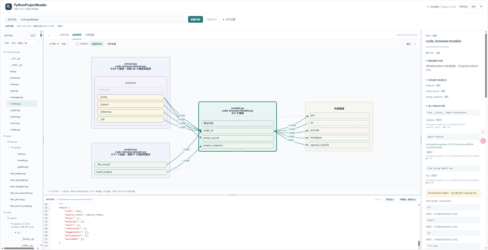

# PythonProjectReader

**简体中文** | [English](./README.en.md)

一个独立运行的本地 Python 项目代码阅读工具。结合文件关系、函数调用、内部逻辑、项目原有注释和只读源码，帮助理解代码实现。

核心分析与查看完全离线，无需 LLM、账号或付费接口，不运行被分析项目。

## 界面预览



文件导航、按文件与类组织的函数调用关系、当前定义说明和只读源码可以联动查看。

## 功能

- 查看模块说明、文件注释、函数、类、全局变量和对象。
- 浏览文件的上游与下游引用，沿跨文件调用继续阅读。
- 调用图按文件、类和函数行组织，展示文件内调用及跨文件的具体函数关系。
- 查看函数签名、参数、默认值、类型注解、返回表达式和调用实参。
- 从局部变量定位绑定位置，进一步查看可确定的类与方法定义。
- 展开条件分支、循环、异常处理等内部逻辑，并定位其中的调用。
- 联动关系图、详情和只读源码，支持搜索、缩放、折叠和前进后退。
- 拖动导航、中央阅读与详情之间的边界，以及中央图与源码之间的边界，调整关注区域。
- 手动关闭提示条，释放阅读空间；分析状态和诊断仍可查看。
- 支持中文、英文界面，默认中文；切换语言保留阅读上下文，不翻译或改写项目源码及注释。
- 提供 Windows、Linux 启动与关闭脚本，优先使用 8778 端口，占用时自动选择空闲端口。

## 环境要求

- Python 3.13。
- Node.js 22：仅安装前端依赖、首次构建或更新网页资源时需要。
- 现代浏览器。
- Windows 使用 PowerShell 5.1 或以上；Linux 使用系统 `sh`。

首次安装依赖需要下载开源软件包。依赖安装与网页构建完成后，日常分析和查看可以离线进行。

## 安装

下载或克隆仓库后，在项目根目录准备环境。

### Windows

以下命令中的 `python` 应指向 Python 3.13。若安装了多个 Python 版本，请使用对应的 3.13 解释器创建虚拟环境。

```powershell
python --version
python -m venv .venv
.\.venv\Scripts\python.exe -m pip install -r requirements.txt
cd web
npm.cmd ci
npm.cmd run build
cd ..
```

### Linux

```bash
python3.13 -m venv .venv
./.venv/bin/python -m pip install -r requirements.txt
cd web
npm ci
npm run build
cd ..
```

网页资源构建到 `code_browser/static/`。该目录不提交到源码仓库，因此首次启动前需要完成构建。日常运行不需要 Node.js 或网页开发服务器。

## 启动与关闭

### Windows

启动：

```powershell
powershell -NoProfile -ExecutionPolicy Bypass -File .\scripts\start.ps1
```

关闭，在另一个终端执行：

```powershell
powershell -NoProfile -ExecutionPolicy Bypass -File .\scripts\stop.ps1
```

可选地预填目标项目目录，或不自动打开浏览器：

```powershell
powershell -NoProfile -ExecutionPolicy Bypass -File .\scripts\start.ps1 -Project "C:\path\to\python-project" -NoBrowser
```

### Linux

启动：

```bash
sh scripts/start.sh
```

关闭，在另一个终端执行：

```bash
sh scripts/stop.sh
```

可选参数：

```bash
sh scripts/start.sh --project "/path/to/python-project" --no-browser
```

启动脚本优先使用 8778 端口；该端口被占用时，由系统分配空闲端口。服务就绪后在终端显示实际访问地址，例如 [http://127.0.0.1:8778/](http://127.0.0.1:8778/)。启动终端保留服务输出。同一工作区已有正常运行的服务时，重复启动会显示并复用该实例的地址。

关闭脚本依据当前工作区的实例记录定位服务，无需知道端口。关闭会结束本工具当前的分析；目标项目文件不会被修改。服务记录和缓存保存在 `work/runtime/`。

脚本根据自身位置查找项目目录，也可以从其他当前目录使用完整脚本路径运行。Windows 和 Linux 分别创建各自平台的 `.venv`，不共用虚拟环境目录。

### 直接使用 Python 入口

也可以在项目根目录使用虚拟环境中的解释器，无需先激活环境。

Windows：

```powershell
.\.venv\Scripts\python.exe -m code_browser
.\.venv\Scripts\python.exe -m code_browser --project "C:\path\to\python-project" --no-browser
.\.venv\Scripts\python.exe -m code_browser --stop
```

Linux：

```bash
./.venv/bin/python -m code_browser
./.venv/bin/python -m code_browser --project "/path/to/python-project" --no-browser
./.venv/bin/python -m code_browser --stop
```

默认优先使用 8778，占用时自动分配空闲端口。传入 `--port 0` 可直接使用系统分配的空闲端口；传入其他 `--port` 值则使用指定端口，占用时报错。服务仅监听 `127.0.0.1`。

## 使用方法

1. 打开终端显示的地址，输入本地 Python 项目目录，点击“分析项目”。
2. 从文件树选择模块，查看已有说明、成员、全局定义及导入。
3. 选择函数，查看输入输出、局部对象、调用者与被调定义。调用图中的文件框包含普通函数，类框包含方法，箭头连接具体定义；当前文件中的未调用成员也可查看。
4. 切换“内部逻辑”，展开分支、循环和异常处理，点击调用查看实参及返回结果的接收位置。
5. 在源码中选中名称，使用“绑定定义”或“所属类 / 最终定义”继续导航。
6. 在调用图内点击函数或文件标题，切换阅读内容并保持图位置；使用“以此为中心”改变范围。关联文件先显示相关成员，可聚焦该文件查看其他成员；大范围支持继续加载并标注未显示数量。
7. 使用返回、前进恢复阅读位置；关系图可按方向、深度和项目范围筛选。
8. 使用顶部语言选项切换中文或 English。切换不重新分析，不改变项目原文。
9. 拖动三个区域分隔条调整导航宽度、详情宽度及源码高度；尺寸在当前页面内保持。也可聚焦分隔条后用对应方向键调整。
10. 点击提示右侧的 × 收起提示；同一自动提示不会反复展开，新的操作错误仍会提示。
11. 修改目标源码后重新分析，避免旧关系与新文本错配。

## 分析设置

- **源码根**：用于源码归属及显式额外扫描目录。普通布局使用项目根，`src` 布局可自动识别，也可手动调整。
- **包目录**：直接选择含 `__init__.py` 的常规包时保留完整包名；自动推导的父级导入搜索目录不会扩大扫描范围。
- **命名空间包**：按显式源码根解释，不猜测目录前缀。
- **依赖源码与类型存根**：可添加只读查询目录，不安装或运行目标依赖。
- **排除目录**：默认排除虚拟环境、缓存和构建目录，不默认排除 `tests`。
- **查询超时**：控制定义和符号引用查询的等待时间，单位为秒。

## 分析边界

PythonProjectReader 展示源码事实和静态查询候选，不模拟程序运行。

- 没有现成说明时不生成职责解释。
- 参数、默认值、返回值和调用实参显示源码表达式，不计算实际运行值。
- 动态导入、运行时生成属性、装饰器变换及回调可能无法确定目标；工具保留候选、外部或未知状态。
- 语法不支持、解码失败或文件不可读时显示诊断，其他文件继续。
- 内部逻辑保留源码结构，不枚举真实循环次数或全部隐式异常路径。
- 符号链接和目录联接不会自动跟随；可使用显式源码根纳入额外目录。

## 源码结构

- `code_browser/`：Python 源码提取、静态导航、本地接口与服务入口。
- `web/`：网页源码及构建配置。
- `scripts/`：Windows 与 Linux 的启动、关闭脚本。

